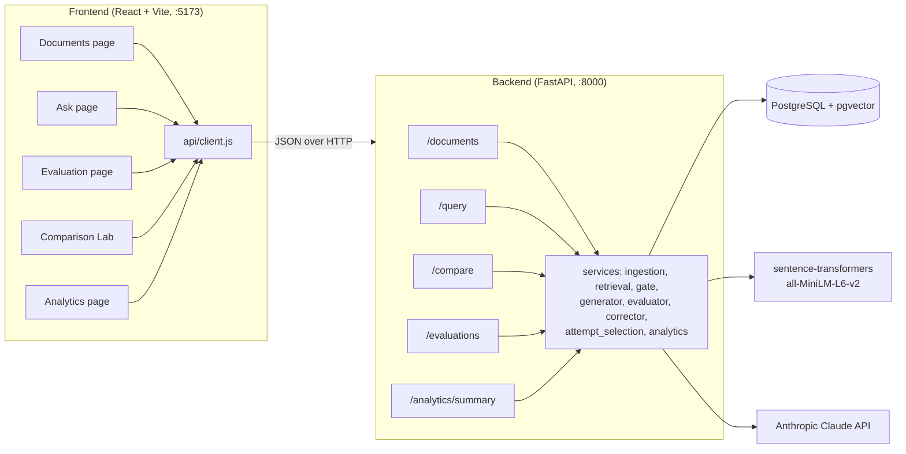
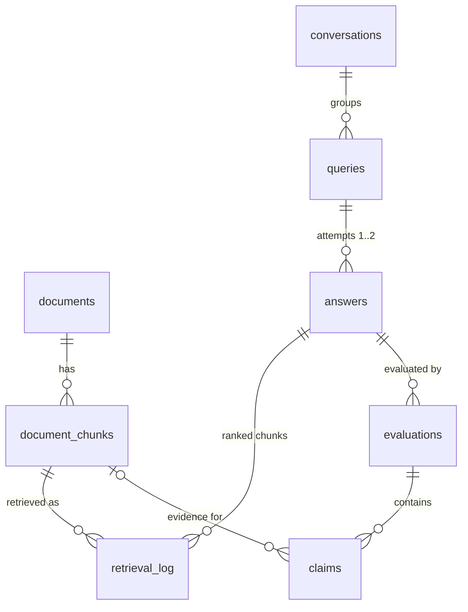
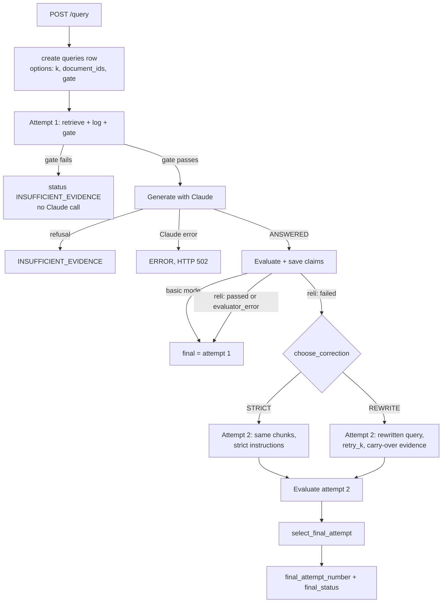

# Attest (RELI-RAG) — Project Report

This report explains how the Attest / RELI-RAG system works end to end: the backend, the frontend,
the database, and how one question moves through the whole system. It also covers the seven
reliability fixes and how the system behaves once they are in place.

> **Scope note.** This report only describes the system. It does not change any code. Section 9
> covers each fix: what was wrong, how the system behaves after the fix, and how to verify it.
> When this was written, the 70% threshold change was already in the working tree and the
> attempt-selection fix was partly done. The remaining items describe the intended behavior after
> the fixes.

---

## 1. What the project is

**RELI-RAG** ("Reliable Retrieval-Augmented Generation") is a question-answering system over
uploaded PDF documents. The user-facing product is called **Attest**. Its main idea is that an
answer is not trusted just because a language model produced it. Every answer is:

1. **Grounded.** It is generated only from passages retrieved from the user's documents, with
   numbered citations such as `[1]`.
2. **Evaluated.** A separate evaluator splits the answer into atomic claims and checks each one
   against the passages. It scores the answer on three metrics and gives a pass/fail verdict.
3. **Corrected when needed.** In RELI mode, if attempt 1 fails, the system makes at most one
   targeted correction (attempt 2). It then keeps whichever attempt is better under explicit rules.
4. **Recorded.** Every attempt, retrieval, evaluation, and claim is stored in PostgreSQL. The
   Evaluation, Comparison, and Analytics pages can then explain what happened and why.

There are two answering modes:

| Mode | What it does |
|---|---|
| **Basic RAG** (`basic`) | Retrieve, gate, generate, and evaluate once. No correction. This is the baseline. |
| **RELI-RAG / Attest** (`reli`) | Same as Basic for attempt 1. If it fails, it diagnoses the failure, runs one correction attempt, re-evaluates, and picks the final attempt. |

The **Comparison Lab** runs both modes on the same question from one shared retrieval. The
**benchmark script** does this for a fixed question set, so the two modes can be compared with
numbers.

---

## 2. Technology stack

| Layer | Technology |
|---|---|
| Backend API | Python, **FastAPI**, Pydantic v2, `pydantic-settings` |
| Database | **PostgreSQL 16 + pgvector** (Docker image `pgvector/pgvector:pg16`), SQLAlchemy 2.x ORM |
| PDF parsing | **PyMuPDF** (`pymupdf`) |
| Embeddings | **sentence-transformers**, model `all-MiniLM-L6-v2` (384-dimensional, normalized) |
| LLM | **Anthropic Claude** (Messages API) for generation, evaluation, and query rewriting |
| Frontend | **React 19**, **Vite 8**, **React Router 7**, **Tailwind CSS 4** |
| Tooling | `unittest`-based offline test scripts (backend), `node --test` (frontend), `httpx` (benchmark runner) |

---

## 3. Repository layout

```
relirag/
├── .env.example                 # every configurable setting, documented
├── docker-compose.yml           # PostgreSQL + pgvector container
├── db/init/01-enable-pgvector.sql
├── backend/
│   ├── app/
│   │   ├── main.py              # FastAPI app, CORS, startup schema migration, routers
│   │   ├── config.py            # Settings (reads ../.env)
│   │   ├── db.py                # engine, SessionLocal, Base, get_db dependency
│   │   ├── models.py            # ORM tables
│   │   ├── schemas.py           # API request/response models
│   │   ├── routers/             # HTTP endpoints: documents, query, compare, evaluations, analytics
│   │   └── services/            # all business logic (see Section 6)
│   ├── calibrate_gate.py        # similarity-gate calibration tool (no Claude calls)
│   ├── sanity_evaluate_saved.py # evaluator sanity run on saved answers + negative cases
│   └── test_*.py                # regression tests (mostly offline)
├── frontend/
│   ├── api/client.js            # every HTTP call to the backend (plus mock mode)
│   └── src/
│       ├── App.jsx, main.jsx    # router + entry point
│       ├── components/          # AppShell (layout/sidebar), AnswerText, EvaluationPanel, ...
│       ├── pages/               # Documents, Ask, Evaluation, Comparison, CorrectionDemo, Analytics
│       ├── evaluationThreshold.js   # shared 70% threshold logic for the UI
│       └── demo/correctionDemo.js   # scripted, clearly labeled correction demo
├── scripts/run_benchmark.py     # runs the benchmark through POST /compare, writes a CSV
├── data/benchmark.json          # 20 benchmark questions (Q01–Q20)
├── data/RELIRAG_Network_Security_Benchmark.pdf   # benchmark source document
└── docs/                        # notes, mock payloads, this report
```

---

## 4. Architecture overview



The frontend never computes answers or verdicts itself. It calls the REST API and displays what
the backend stored. The backend is the single source of truth for answers, scores, verdicts, and
the choice of final attempt.

---

## 5. Data model (PostgreSQL)



| Table | Purpose and key columns |
|---|---|
| `documents` | One uploaded PDF: `filename`, `total_pages`, `total_chunks`, `uploaded_at`, `deleted_at` (soft delete). |
| `document_chunks` | One text window of a page: `page_number`, `chunk_index`, `content`, `embedding vector(384)`. |
| `queries` | One question run in one mode: `question`, `mode` (`basic`/`reli`, enforced by a CHECK constraint), `options` (JSON: `k`, `retry_k`, `document_ids`, `similarity_gate`, `compare_id`), `final_status`, `final_attempt_number`, `benchmark_run_id`. |
| `answers` | One attempt: `attempt_number` (unique per query), `answer_text`, `retrieval_query`, `strategy` (`rewrite`/`strict`/null), `status` (`ANSWERED`, `INSUFFICIENT_EVIDENCE`, `ERROR`), `model`, `latency_ms`, token counts. |
| `retrieval_log` | Which chunks an attempt saw, in which `rank`, with what `similarity`. Citation `[n]` refers to rank `n`. |
| `evaluations` | One evaluation of an attempt: `faithfulness`, `answer_relevance`, `context_relevance`, `passed`, `failure_type`, `feedback`, `model`, `latency_ms`, tokens. |
| `claims` | One atomic claim: `claim_text`, final `verdict`, `evidence_chunk_id`, `evidence_quote`, plus audit fields `claude_verdict` (Claude's verdict before deterministic checks), `evidence_error` (why a check changed it), `check_name` (`evidence`/`support`/`citation`/`uncited`/`limitation`). |

Design decisions worth knowing:

- **Everything is history.** Attempts are never overwritten. A correction adds a new `answers` row
  (attempt 2). A re-evaluation adds a new `evaluations` row, and readers always use the latest one
  (highest `id`).
- **Soft deletion.** If any past attempt retrieved a document, deleting it only sets `deleted_at`.
  The document disappears from listings and search, but old citations and claims stay intact. A
  document no attempt ever used is deleted outright, and its chunks go with it via `ON DELETE CASCADE`.
- **Run settings are frozen per query.** `queries.options` records `k`, `document_ids`, and the
  similarity gate in effect, so a stored run can be explained later even if `.env` changes.

---

## 6. Backend in detail

### 6.1 Configuration (`app/config.py`, `.env`)

`Settings` loads the repository-root `.env`. The most important values:

| Setting | Default | Meaning |
|---|---|---|
| `DATABASE_URL` | — (required) | SQLAlchemy URL for PostgreSQL. |
| `CORS_ORIGINS` | `localhost:5173`, `127.0.0.1:5173` | Browser origins allowed to call the API. |
| `MAX_UPLOAD_MB` | 20 | Upload size limit (HTTP 413 above it). |
| `SIMILARITY_GATE` | 0.30 | Minimum top-1 cosine similarity before Claude is called. |
| `CHUNK_SIZE` / `CHUNK_OVERLAP` | 800 / 150 | Character window size and overlap for chunking. |
| `EMBEDDING_MODEL` | `all-MiniLM-L6-v2` | Must output 384-dimensional vectors. |
| `CLAUDE_MODEL`, `ANTHROPIC_API_KEY` | — | Generation model and key. |
| `CLAUDE_MAX_TOKENS` | 1024 | Generation budget (auto-doubled up to 4096 if truncated). |
| `EVALUATOR_MODEL` | falls back to `CLAUDE_MODEL` | Evaluator model. |
| `EVALUATOR_MAX_TOKENS` | 2048 | Evaluator budget (auto-doubled up to 8192 if truncated). |
| **`EVALUATOR_PASS_THRESHOLD`** | **0.70** | Every one of the three scores must be at least this for a pass. |
| `EVALUATOR_MAX_PARSE_ATTEMPTS` | 2 | How many invalid-JSON evaluator replies are tolerated. |

### 6.2 Startup and schema migration (`app/main.py`)

On startup, the FastAPI `lifespan` hook:

1. Runs `CREATE EXTENSION IF NOT EXISTS vector`.
2. Runs `Base.metadata.create_all()` to create any missing tables.
3. Runs idempotent `ALTER TABLE ... ADD COLUMN IF NOT EXISTS ...` statements for columns added
   after the first deployment: `answers.model`, `answers.strategy`, `queries.final_attempt_number`,
   `evaluations.model/latency_ms/input_tokens/output_tokens`, `documents.deleted_at`, and
   `claims.claude_verdict/evidence_error/check_name`.

There is no Alembic. Migrations are these idempotent statements, so they are safe to run on every
start. Section 9.7 explains how to apply and verify them.

### 6.3 LLM client (`services/llm.py`)

`call_claude()` is the only place that talks to Anthropic. It sends one Messages API request,
retries once on transient failures (connection errors, rate limits, HTTP 5xx) with backoff, and
returns an `LLMResult` with text, model, token counts, latency, `stop_reason`, and attempt count.
Failures raise `LLMError`, which the API turns into HTTP 502.

### 6.4 Document ingestion (`routers/documents.py`, `services/ingestion.py`)

`POST /documents/upload`:

1. **Validates** that the file name ends in `.pdf`, the content type is a PDF type, the size is
   at most `MAX_UPLOAD_MB`, and the bytes start with `%PDF-`.
2. Inserts a `documents` row.
3. **Extracts** text page by page with PyMuPDF and normalizes whitespace. Empty pages are skipped.
4. **Chunks** each page separately into fixed 800-character windows with 150-character overlap.
   A chunk never spans two pages, so every chunk has an exact page number.
5. **Embeds** all chunks with sentence-transformers (normalized vectors) and bulk-inserts them.
6. If the PDF is unreadable (422) or has no extractable text (422, for example scanned images),
   the document row is discarded.

`GET /documents` lists the non-deleted documents. `DELETE /documents/{id}` hides the document
first, so no new attempt can retrieve it, and then either soft-deletes or hard-deletes it as
described in Section 5.

### 6.5 Retrieval (`services/retrieval.py`)

`retrieve(db, question, k, document_ids)`:

- Embeds the question with the same model and normalization as the chunks.
- Runs a pgvector **cosine-distance nearest-neighbour search** and returns the top `k`
  (default 5, max 50). Similarity = `1 − cosine distance`.
- **Document filter:** `document_ids=None` searches all documents. A list restricts the SQL query
  to `document_id IN (...)`. An **empty list returns nothing**, so the gate then rejects the
  question. Unknown IDs match nothing; in a mixed list only the existing documents are searched.
  Soft-deleted documents are always excluded, even when selected explicitly.
- **Deterministic ranking:** results are ordered by distance and then chunk ID, so equal
  distances (for example identical text in two documents) always come back in the same order.
- **Repeated passages:** a chunk whose text repeats a higher-ranked chunk word for word (ignoring
  case and whitespace), such as the same PDF uploaded twice, is skipped so it does not take a
  second of the `k` places. If skipping leaves fewer than `k` chunks, the search reads deeper, up
  to 4 × `k` candidates. Overlapping chunks with different text are kept. Without repeats, one
  search of `k` is made, as before.
- **Multi-topic questions:** `split_requirements()` detects questions that list several
  requirements: bulleted or numbered lists, several `?`-questions, or in-sentence enumerations
  such as "explain A, B, and C". Lead-ins like "According to the document" are dropped. For such
  questions:
  - each requirement (up to 6) is embedded and searched separately;
  - requirement matches below `SIMILARITY_GATE` are dropped;
  - the whole-question ranking and the per-requirement rankings are merged with **reciprocal
    rank fusion** (RRF, constant 60);
  - the whole question's best chunk is always kept and the result is sorted by similarity to the
    whole question, so the similarity gate checks exactly the same top-1 chunk as a plain search.

  This lets every topic of a multi-part question be represented in the context, instead of the
  dominant topic taking all `k` slots.

### 6.6 Similarity gate (`services/similarity_gate.py`)

`retrieve_with_gate()` creates the `answers` row for the attempt and logs every retrieved chunk to
`retrieval_log` (even when the gate fails, for traceability). It then checks
`top-1 similarity >= SIMILARITY_GATE`. If the check fails, the attempt becomes
`INSUFFICIENT_EVIDENCE` and **Claude is not called**. For correction attempts, chunks carried over
from attempt 1 are merged in only after the attempt's own retrieval passes the gate.

### 6.7 Answer generation (`services/generator.py`)

The generator's system prompt tells Claude to:

- use **only** the numbered context passages;
- address every part of the question that the context supports;
- cite every claim as `[n]`, and never cite a number that does not exist;
- reply with exactly `INSUFFICIENT_EVIDENCE` if the context cannot answer the question;
- if only part of the question is covered, answer what it can and **plainly say which part is not
  covered**, in a separate sentence without a citation.

Post-processing:

- A reply that starts with `INSUFFICIENT_EVIDENCE` is a refusal, and the attempt status becomes
  `INSUFFICIENT_EVIDENCE`.
- Stray refusal tokens inside a real answer are stripped.
- A reply cut off at `max_tokens` is retried with double the budget (up to 4096). A truncated
  answer is never saved as `ANSWERED`.
- Valid citations are parsed in order of first appearance.

**Strict mode** (used by the corrector) appends extra instructions. It lists the rejected claims,
forbids repeating them unless a passage states them explicitly, and requires a citation on every
factual sentence.

**Correction instructions** (used by every REWRITE retry) append the failure descriptions and the
evaluator's feedback (whitespace collapsed, at most 1,500 characters). They tell Claude to cover
every part of the question the passages support, including what the previous answer left out;
that the feedback only says what to look for and **is not evidence**; and to say plainly that a
part is not covered rather than guess. `INSUFFICIENT_EVIDENCE` is allowed only if the passages
answer no part of the question.

### 6.8 Evaluation (`services/evaluator.py`, `services/answer_checks.py`)

This is the core of the reliability story. `evaluate_answer(question, answer, chunks)` works in
two layers.

**Layer 1: Claude as judge.** A strict evaluator prompt asks Claude to return one JSON object:

- `claims`: the answer split into atomic factual claims. Each claim has a verdict (`supported`,
  `partially_supported`, or `unsupported`), the `evidence_chunk_id`, and a verbatim
  `evidence_quote`. Claude is told to judge **meaning, not wording**: a paraphrase that says the
  same thing is supported, while a changed subject, entity, relationship direction, quantity, or
  qualifier ("always", "all", a dropped "may") is not. Two optional lists per claim:
  `additional_evidence` (other passages needed together to support it) and
  `conflicting_evidence` (passages that contradict it about the same subject **under the same
  conditions**; passages about a different period, scope, or condition must not be listed).
- `limitations`: sentences that only say something is missing or uncertain. These are not claims.
- `answer_relevance` (0–1): how directly and completely the answer addresses every part of the
  question.
- `context_relevance` (0–1): how well the passages alone contain the needed information.
- `feedback`: one to three sentences naming the problems. For each unanswered part it says whether
  the passages contain the information (the answer left it out) or not.

The reply is validated with strict Pydantic models. Invalid JSON is retried with the error message
(up to `EVALUATOR_MAX_PARSE_ATTEMPTS`). A truncated reply is retried with a doubled budget. If all
of that fails, the result is `failure_type = evaluator_error`, with `passed = false` and no
scores.

**Layer 2: deterministic verification.** Claude is the semantic judge; these checks only verify
hard facts against the evidence actually retrieved for the attempt and can only **lower** a
verdict, never raise it:

| Check (`check_name`) | Rule | Effect |
|---|---|---|
| `evidence` | The cited `evidence_chunk_id` must be one of the attempt's retrieved chunks, and the `evidence_quote` must occur in it word for word, in order (case, whitespace, punctuation, curly quotes/dashes, and words hyphenated across a PDF line break are ignored). Additional and conflicting evidence is verified the same way; anything unverifiable is dropped, never trusted. | Invalid main evidence makes the claim **unsupported**. |
| `support` | Checked against all of the claim's verified evidence together: every number (in digits or words, so "3" = "three" and "four" ≠ "three") occurs in the evidence chunks; every name in the claim (acronyms, codes such as "X200", capitalized names) occurs there, and a quote stating the rest of the claim about a **different** name makes it unsupported (partial when both names appear in that sentence); the quotes share enough of the claim's content words (≥ 50% for "supported", ≥ 25% and 2 words for "partial"); polarity matches (negations are counted, so "cannot … without" reads as positive) and a quote with every content word but the opposite polarity **contradicts** the claim; the claim does not generalize ("always", "all") or drop a hedge ("may", "some") beyond the evidence sentences; names do not appear in reversed order. A verified, relevant `conflicting_evidence` passage (it must mention the claim's names and address its content) leaves the claim at most partial, recording the chunk, document, page, and quote. | Lowers the verdict: unsupported, or partially supported. |
| `citation` | The answer sentence that states the claim must cite an existing passage that contains one of the claim's evidence quotes. | A supported claim with a missing, invalid, or unrelated citation becomes **partially supported**. |
| `uncited` | A factual sentence (including a negative one) that no claim covers and that has no valid citation. | Added as an extra **unsupported** claim. |
| `limitation` | A limitation must refer to the sources or what they state ("the passages do not say…", "it is unclear…", "I could not find…") and contain no contrasting clause. A "limitation" that asserts a fact, including a plain negative fact ("X does not do Y"), is scored as a claim. | Scored as an **unsupported** claim, so facts cannot dodge checking by being labeled limitations. |

Repeated claims (same text apart from case, whitespace, and final punctuation) are counted once,
with the lowest verdict among them. Claude's original verdict is kept in `claude_verdict`, and the
reason and check name are stored, so every downgrade can be audited. Additional and conflicting
evidence are used for scoring and correction carry-over but are not stored as separate columns;
a conflict that downgrades a claim is recorded in its `evidence_error`. The local embedding model
was evaluated as a semantic signal and rejected: it scored wrong-entity, negated, and reversed
statements (0.82–0.97) above genuine paraphrases (0.59–0.85).

**Scoring.**

- **Faithfulness** is computed by the backend, not by Claude:
  `(supported + 0.5 × partially_supported) / total_claims`.
- If the answer contains only limitation statements, nothing in it is unfaithful
  (faithfulness = 1.0), but nothing is answered either (answer relevance forced to 0.0).
- **Pass rule:** an answer passes only if all three scores are finite and **≥ 0.70**. A score
  exactly at 0.70 passes, and NaN or infinite values always fail.
- **Failure type** is the first failing score, in this order:
  faithfulness → `unsupported_claim`, answer relevance → `missing_info`,
  context relevance → `irrelevant_retrieval`.
- **Feedback** is Claude's feedback plus one note for each deterministic check that changed
  something.

### 6.9 Correction (`services/corrector.py`)

`choose_correction(evaluation)` decides whether and how to correct a failed attempt 1.

1. `failure_signals()` collects **every** failing score, not just the stored first one. Example:
   an answer can be both unfaithful and incomplete.
2. Strategy:
   - **STRICT** applies only when the problem is purely unsupported claims and context relevance
     is ≥ 0.70, meaning the evidence was fine and generation was the problem. It regenerates
     from the **same chunks** with strict instructions listing the rejected claims.
   - **REWRITE** applies to anything involving missing information or weak retrieval. Claude
     rewrites the **search query** using the evaluator's feedback, keeping every entity and
     constraint of the original question and adding nothing new. The system then:
     - retrieves again with a larger `retry_k = max(k, 8)` and the **same document filter**;
     - carries over attempt 1's verified evidence: the main, additional, and conflicting
       evidence chunks of its supported and partially supported claims. When attempt 1's
       passages were judged adequate (context relevance ≥ 0.70), **all** of its passages are
       carried over, since one of them may hold the part the answer left out; weak passages are
       kept only if they back a claim. Each chunk appears once;
     - generates with the **correction instructions** (Section 6.7), preceded by strict
       instructions listing the rejected claims if unsupported claims were also a problem.

     The answer is still generated for the **original** question. The rewrite is only used for
     retrieval and is saved as `retrieval_query`. If the rewrite is unusable (empty, multi-line,
     too long, or unchanged), the original question is used with the larger `k`.
3. No correction runs for gate rejections, refusals, passing answers, or `evaluator_error`.

### 6.10 Final-attempt selection (`services/attempt_selection.py`)

After attempt 2 is evaluated, `select_final_attempt()` decides which attempt the query reports.
Attempt 1 is kept unless attempt 2 is **better** by these rules:

- Attempt 2 needs a usable evaluation: `ANSWERED`, evaluated, not `evaluator_error`, and all
  scores finite and within 0–1. An attempt counts as passing only if its evaluation is usable,
  `passed` is true, and it has no failure type, so contradictory or out-of-range records cannot
  create a pass.
- If attempt 1 has no usable evaluation, attempt 2 wins only if it **passes**.
- A failing attempt never replaces a passing one.
- Faithfulness may drop by at most **0.05**, and only when attempt 2 starts passing or gains at
  least **0.10** answer relevance.
- If attempt 2 passes where attempt 1 failed, attempt 2 wins.
- Otherwise, with the same pass status: more complete (answer relevance) wins, then more
  faithful. Answer relevance may drop by at most 0.05, and only for a more faithful answer.
  Context relevance only breaks ties. An exact tie keeps attempt 1.

The choice is saved as `queries.final_attempt_number` and `queries.final_status`. Every reason
is a readable sentence, for example "attempt 2 passed and attempt 1 did not". The API returns it
as `selection_reason`, derived when the response is built by replaying the same rules on the
stored attempts; if the stored choice differs from the rules (for example a run interrupted
before recording its choice), the reason says so instead of inventing one.

### 6.11 The query pipeline (`services/query_pipeline.py`)



Guarantees:

- Each step commits as it goes, so a crash leaves a truthful partial record.
- Attempt 1 is committed as the final attempt **before** correction starts. If anything in
  attempt 2 fails, the query still reports attempt 1, and attempt 2 is marked `ERROR` instead of
  being left without a status.
- An attempt-1 failure marks the whole query `ERROR` (with a fallback to a fresh session if the
  current one is broken).
- Evaluation never changes an answer's text or status. It only adds evaluation rows.

### 6.12 Comparison (`services/compare.py`, `POST /compare`)

`run_compare()` retrieves **once**, creates one `queries` row per mode linked by a shared
`compare_id` (and an optional `benchmark_run_id`), then runs Basic and RELI **in parallel
threads, each with its own DB session**, from the same chunks. If one branch fails, it is marked
`ERROR` without affecting the other. The endpoint returns 200 if at least one branch finished, and
502 if both failed.

### 6.13 Query responses (`routers/query.py`)

`POST /query` and `GET /query/{id}` return a `QueryResponse` with:

- `status` (the query's `final_status`), `final_attempt_number`, `selection_reason` (Section
  6.10), and `final_answer`. The final answer is the selected attempt's text, or a fixed
  user-friendly message: no passages could be retrieved (empty selection, unknown or deleted
  documents only), passages below the similarity threshold, "not supported" (Claude refused),
  or error;
- `attempts[]`: for each attempt, its answer, `retrieval_query`, `strategy`, status, model, valid
  `citations`, the full `retrieval` list (rank, document, page, similarity, content), its
  **latest** evaluation with all claims and audit fields, and timings and tokens.

### 6.14 Evaluation history and CSV export (`routers/evaluations.py`)

- `GET /evaluations?status=passed|failed|evaluator_error&document_id=&latest_only=true&limit=&offset=`
  returns a paginated list of stored evaluations, newest first. Each item includes the query,
  attempt, scores, claims, and the documents the attempt retrieved.
- `GET /evaluations/export.csv` exports the same rows as CSV, with claim counts per verdict,
  document IDs and names, an `is_latest` flag, and protection against spreadsheet formula
  injection (cells starting with `= + - @` are prefixed with `'`).

### 6.15 Analytics (`services/analytics.py`, `GET /analytics/summary`)

This endpoint aggregates everything in scope (all queries, or one `benchmark_run_id`):

| Metric | Definition |
|---|---|
| `total_questions` | `queries` rows in scope. A `/compare` call adds one per mode. |
| `first_pass` | Attempt 1 passed its latest usable evaluation, out of queries whose attempt 1 has one. |
| `by_mode.*.final_pass` | The **reported** attempt passed its latest usable evaluation, out of queries whose reported attempt has one. The benchmark summary's "final answers passed" uses the same definition. |
| `corrections.eligible` | RELI queries whose attempt 1 failed a usable evaluation. |
| `corrections.triggered` | RELI queries that have an attempt 2. |
| `corrections.successful` | Triggered queries whose reported attempt is attempt 2 and passed. |
| `insufficient_evidence` | Queries whose final status is `INSUFFICIENT_EVIDENCE`. |
| `first_attempt_scores` / `final_scores` | Average faithfulness, answer relevance, context relevance, and overall (the mean of the three), for attempt 1 and for the **reported** attempt. |
| `unsupported_claims`, `partially_supported_claims` | Claim counts. |
| `latency` | Per query: generation latency of all attempts plus latest-evaluation latency of each attempt (retrieval and query rewriting not included). All three averages use the same denominator (queries with any recorded Claude time), and a part with no recorded time counts as 0 ms, so `avg_generation_ms + avg_evaluation_ms = avg_total_ms`. |
| `top_documents` | Most-retrieved documents (retrieval-log rows and distinct queries). |

Evaluations with `evaluator_error` are excluded from rates and averages (the benchmark summary
excludes them too and reports how many it left out). Stored verdicts are used as recorded; they
are never rescored under the current threshold. Rates are `null` when their denominator is 0.

### 6.16 API reference

| Method & path | Purpose |
|---|---|
| `GET /health` | Liveness (`{"status":"ok"}`); polled by the frontend every 15 s. |
| `POST /documents/upload` | Upload and ingest a PDF (multipart `file`). |
| `GET /documents` | List active documents. |
| `DELETE /documents/{id}` | Delete (soft or hard) a document. |
| `POST /query` | `{question, mode: basic\|reli, k, document_ids}` runs a pipeline and returns a `QueryResponse`. |
| `GET /query/{id}` | Reload a stored query with all attempts. |
| `POST /compare` | `{question, k, document_ids, benchmark_run_id}` runs both modes and returns `{basic, reli}`. |
| `GET /evaluations` | Paginated evaluation history with filters. |
| `GET /evaluations/export.csv` | CSV export of evaluations. |
| `GET /analytics/summary` | Aggregated metrics, optionally for one benchmark run. |

FastAPI's interactive docs are at `http://localhost:8000/docs`.

---

## 7. Frontend in detail

### 7.1 Structure and data flow

- `main.jsx` mounts `<App/>`. `App.jsx` defines the routes inside `AppShell`:
  `/documents`, `/ask`, `/evaluation` (latest query), `/query/:id` (a specific query),
  `/comparison`, `/correction-demo`, and `/analytics`. Unknown paths redirect to `/documents`.
- **`api/client.js`** is the only module that talks to the backend. `VITE_API_BASE_URL` sets the
  backend URL (default `http://localhost:8000`). `VITE_USE_MOCK=true` switches documents and query
  calls to canned data. Pages that need real history (Evaluation, Comparison, Analytics) refuse to
  run in mock mode and say so.
- **`AppShell.jsx`** is the sidebar layout with navigation. It also shows a live **System Status**
  badge driven by `GET /health` every 15 seconds (Online, Offline, Connecting, or Mock Mode).
- **State.** Pages use local React state. The last query ID is kept in `sessionStorage`, so the
  Evaluation page can open "the latest" query. Recent query history (up to 10) and Ask-page
  preferences are kept in `localStorage`.

### 7.2 Pages

| Page | What it does |
|---|---|
| **Documents** | Drag-and-drop or pick a PDF, upload it, and see the table of documents (pages, chunks, upload time). Delete with confirmation. |
| **Ask** | The main workspace. Pick the mode (**RELI** is the default, Basic is the alternative), choose which documents to search (all selected by default, and at least one required), and type a question. The request goes to `POST /query`. A pipeline animation (Retrieve, Generate, Evaluate, Correct, Re-evaluate) runs while waiting; it is time-based because the backend replies in one request. The result shows the final answer (rendered by `AnswerText`, which supports bold, lists, and headings), status badge, the **reported** attempt's evaluation summary, an evidence explorer (cited passages with page and similarity), a retrieval debug panel, and a recent-history sidebar. Every question goes to the backend; there are no question-specific or scripted results. |
| **Evaluation** (`/evaluation`, `/query/:id`) | A deep dive on one query loaded with `GET /query/{id}`. It shows the score cards for the **final attempt**, the "Evaluator threshold check" (each score against **70%**), the claim-by-claim analysis with evidence quotes and audit details, attempt history (attempt 1 and attempt 2, marking which one is final), before/after score comparison with differences in percentage points, and correction diagnostics (failure type, feedback, original and rewritten retrieval query). |
| **Comparison Lab** | Sends one question to `POST /compare` and shows Basic and RELI side by side: the reported attempt of each, the three scores, the verdict, status, and answer. |
| **Correction Demo** | A **scripted, clearly labeled** walkthrough of the correction flow (attempt 1 covers only one of three topics, then a rewrite, then attempt 2 covers all three). It never calls Claude or the database, and it is only reachable as its own page; the Ask page does not use it. |
| **Analytics** | Loads `GET /analytics/summary`, optionally filtered by benchmark run ID and with a top-N documents limit. It shows first-pass and final pass rates, correction trigger and success rates (a correction counts as successful only when attempt 2 is the reported answer and passed), insufficient-evidence and unsupported-claim counts, Basic and RELI final score bars, latency, and the most-used documents. |

### 7.3 Shared threshold logic (`src/evaluationThreshold.js`)

`EVALUATOR_PASS_THRESHOLD = 0.7` mirrors the backend setting. `thresholdCheck(evaluation)` returns
a pass/fail result per score and an overall status: `passed`, `below_threshold`, `incomplete`,
`evaluator_error`, or `not_evaluated`. It also returns `matchesVerdict`, which flags old rows whose
stored verdict was recorded under a different threshold. The backend test
`test_pass_threshold.py` and the frontend test `evaluationThreshold.test.js` both read the same
boundary cases from `evaluationThreshold.cases.json`, so the two sides cannot drift apart.

### 7.4 How the frontend picks "the answer" to show

Everywhere (Ask, Evaluation, Comparison, benchmark script), the rule is the same: **use the
attempt whose `attempt_number` equals `final_attempt_number`**. The answer text, scores, verdict,
claims, evidence, and citations shown together all come from that one attempt. Other attempts
appear only in the attempt history.

---

## 8. End-to-end example

Question (RELI mode, one document selected):
*"Explain network segmentation, MFA, and centralized logging, and one limitation of each."*

1. **Ask page** sends `POST /query {question, mode:"reli", k:5, document_ids:[8]}`.
2. **Retrieval** sees a three-item enumeration. It searches the whole question plus
   "network segmentation", "MFA", and "centralized logging" separately, fuses the rankings with
   RRF, and returns 5 chunks covering all three topics. Every chunk comes from document 8.
3. **Gate:** top-1 similarity (for example 0.58) ≥ 0.30 passes. The chunks are logged.
4. **Generation** produces a cited answer. Suppose it covers segmentation and MFA but says the
   context does not describe a limitation of centralized logging.
5. **Evaluation:** the claims are supported (faithfulness 0.95), but answer relevance is 0.60
   (one part not answered), and context relevance is 0.75. Answer relevance is below 0.70, so the
   answer fails with `failure_type = missing_info`.
6. **Correction:** the signals are `[missing_info]`, so the strategy is **REWRITE**. Claude
   rewrites the search query to target "centralized logging limitations (noisy alerts)". The
   system retrieves 8 chunks from document 8 only, merges in attempt 1's supporting chunks, and
   generates attempt 2.
7. **Re-evaluation:** attempt 2 scores faithfulness 0.92, answer relevance 0.90, context
   relevance 0.85, and **passes**.
8. **Selection:** attempt 2 passes where attempt 1 failed, and faithfulness dropped by only 0.03
   (within 0.05), so attempt 2 is selected. `final_attempt_number = 2`, `final_status = ANSWERED`.
9. **Response:** the Ask page shows attempt 2's answer with its scores and verdict ("PASSED").
   The Evaluation page shows both attempts, the before/after scores, and why attempt 2 was chosen.
   Analytics counts the query as eligible, triggered, and successful.

---

## 9. The fixes, and how the system behaves after them

### 9.1 Evaluation thresholds set to 70% everywhere

**Problem.** The pass threshold was 0.80 in `config.py` and `.env.example`, while the frontend
used its own 0.7 from a browser setting. Results could disagree: the UI could say "all scores
pass" while the backend verdict was "failed".

**After the fix.**

- One threshold, **0.70**, defined in `EVALUATOR_PASS_THRESHOLD` (backend default and
  `.env.example`). It is used by the verdict (`determine_failure_type`), correction triggering
  (`failure_signals` and `choose_correction`), and STRICT-vs-REWRITE context adequacy.
- Scores are on a 0–1 scale. A score passes when it is finite and `>= 0.70`. Exactly 0.70
  passes, and NaN or infinite values fail.
- The frontend's `evaluationThreshold.js` mirrors 0.70. The user-editable "evaluator threshold"
  preference was removed, so the UI can no longer disagree with the backend.
- The Evaluation page's threshold check explains when an old stored verdict differs (it was
  recorded under the old 80% threshold). Old rows are not rewritten, so their history stays
  truthful.

**Verification.** `python backend/test_pass_threshold.py`, `python backend/test_evaluator.py`,
and `npm test` in `frontend/`. The backend and frontend tests share the boundary cases in
`evaluationThreshold.cases.json`.

> Note: an existing local `.env` that still says `EVALUATOR_PASS_THRESHOLD=0.80` overrides the
> default. Update it to 0.70 and restart the backend.

### 9.2 Final-answer and attempt selection, and verdict consistency

**Problem.** The final answer, scores, verdict, and "reported attempt" could describe different
attempts. Examples: a page falling back to the *last* attempt instead of the *selected* one; a
verdict shown from attempt 1 next to attempt 2's text; an attempt 2 that crashed left with no
status.

**After the fix.**

- The backend decides the final attempt once, in `attempt_selection.py`, and stores it in
  `final_attempt_number` and `final_status`. `final_answer`, the shown scores, verdict, claims,
  and citations always come from that same attempt.
- Selection produces a readable **reason** ("Attempt 2 was selected over attempt 1: attempt 2
  passed and attempt 1 did not."). Attempts without a usable evaluation are explained too ("its
  evaluation is an evaluator error").
- Basic mode always reports attempt 1. RELI reports attempt 1 unless attempt 2 is better by the
  rules in Section 6.10. An exact tie keeps attempt 1.
- If attempt 2 fails mid-way, it is marked `ERROR` and attempt 1 stays final. A failed `/compare`
  branch records its final attempt the same way (`record_failure`).
- A record with `passed = true` but a failure type, or with a score outside 0–1, can no longer be
  selected as a pass.
- `selection_reason` is returned with every query (Section 6.10).
- The frontend uses `final_attempt_number` everywhere (Ask, Evaluation, Comparison, benchmark).
  It falls back to the last attempt only for legacy rows that have no recorded final attempt.
  The Evaluation page compares attempt 1 with the correction attempt that actually ran, marks
  which one is reported, and shows the selection reason; the Ask page's "Evaluate" and
  "Re-evaluate" stages show attempt 1's and the retry's evaluation respectively.

**Verification.** `test_final_selection.py`, `test_attempt_selection.py`, `test_reli_rag.py`,
`test_query_status.py`, and `test_compare.py`.

### 9.3 Faithfulness and claim-evidence verification

**Problem.** Faithfulness depends on the evaluator's claim verdicts. If Claude marks a claim
"supported" with a quote that is not in the passage, or that does not actually state the claim,
faithfulness is inflated. Factual sentences without citations, or facts disguised as
"limitations", could also escape checking.

**After the fix.**

- Faithfulness is computed **only from verified verdicts**, never from Claude's raw judgment:
  `(supported + 0.5 × partial) / total`. The formula and the 0.70 threshold are unchanged.
- Every supported or partial claim must point to a **retrieved** chunk and quote its text word
  for word (punctuation and PDF line-break hyphenation no longer cause false rejections).
  Otherwise the claim is unsupported (`check_name = evidence`).
- The evidence must actually support the claim (`support`, Section 6.8). Reproduced defects that
  are now fixed: a wrong number written as a word ("four-way" for "three-way") was accepted; the
  same number in digits and words ("3" vs "three") was rejected; a quote stating the exact
  opposite earned half credit; a double negative was treated as a negation; a claim with a
  swapped subject ("X does Y" for evidence about Z) was accepted.
- Claims supported only by several chunks together can cite them all; a passage that
  contradicts a claim about the same subject and conditions is recorded with its source.
- The answer sentence must cite a passage that contains the evidence (`citation`). Uncited
  factual sentences, including negative ones, become unsupported claims (`uncited`).
- Facts labeled as limitations, including plain negative facts, are scored as unsupported
  (`limitation`). Real limitation statements (about what the sources do not say) are not counted.
- A claim repeated by the evaluator is counted once, with its lowest verdict.
- Every change is auditable through `claude_verdict`, `evidence_error`, and `check_name`, shown
  on the Evaluation page and in the CSV.

**Verification.** `test_evidence_verification.py`, `test_evidence_semantics.py`,
`test_evaluator.py`, `test_evaluator_sanity.py`, and (with Claude credits)
`python backend/sanity_evaluate_saved.py --negatives`. The latter runs controlled wrong answers
(for example "UDP guarantees delivery") and checks that they are caught.

### 9.4 Incomplete answers and correction behavior

**Problem.** An answer that covers only some parts of a multi-part question could still pass, or
the correction could fix one problem and ignore another. Examples: it rewrote for
`irrelevant_retrieval` but ignored that claims were also unsupported, or the retry lost attempt
1's good evidence.

**After the fix.**

- The generator must say explicitly which part is not covered. The evaluator treats an "I can't
  answer this part" sentence as **unanswered**, so answer relevance drops and the answer fails
  with `missing_info` when it falls below 0.70. A limitations-only answer always fails
  (answer relevance 0).
- `failure_signals` considers **all** failing scores, so a correction addresses all of them.
- Missing information or weak retrieval leads to **REWRITE**: a feedback-targeted search query, a
  larger `retry_k`, the **same document filter**, attempt 1's evidence carried over (Section 6.9),
  and rejected claims forbidden. A pure unsupported-claim problem with good context leads to
  **STRICT** regeneration from the same chunks.
- Two reproduced defects are fixed: the retry's generator was never told what was missing (the
  evaluator's feedback only reached the query rewriter), so it could only rephrase; and a
  passage attempt 1 had retrieved but not cited, which could hold the omitted part, was dropped
  when the new search did not return it. The retry now gets the correction instructions with the
  feedback (which is explicitly not evidence), and adequate attempt-1 passages are all kept.
- Attempt 2 replaces attempt 1 only if it is genuinely better (Section 6.10). A "more complete
  but much less faithful" answer, a rephrase with equal scores, or a retry that invents details
  is not selected.
- At most one correction runs per query, so cost and latency stay bounded.

**Verification.** `test_answer_completeness.py`, `test_corrector.py`, and `test_reli_rag.py`
(all offline, with mocked Claude replies). Live: benchmark questions
Q09–Q13 (`multipart_comparison`).

### 9.5 Multi-topic retrieval and document filtering

**Problem.** For questions that ask about several topics, plain top-k search tends to return
chunks about the dominant topic only, so later parts go unanswered. Document filtering must also
hold on every path: attempt 1, the shared compare retrieval, and correction retries.

**After the fix.**

- `split_requirements()` detects lists, multiple questions, and "A, B, and C" enumerations. It
  drops lead-ins and searches each requirement (up to 6) separately. The results are fused with
  RRF so that every requirement is represented within `k`.
- The whole question's best chunk is always rank 1, so the **gate decision does not change**
  because of the split.
- Weak requirement matches (below the gate) are dropped and do not pollute the context.
- `document_ids` is applied in SQL to every search, including per-requirement searches and the
  REWRITE retry, and it is recorded in `queries.options`. An empty selection retrieves nothing
  (gate: insufficient evidence). Soft-deleted documents are never searched. The Ask page requires
  at least one selected document. The Comparison Lab sends `null` (all documents) when the
  selection is empty, which is the documented "search everything" behavior.
- Reproduced defects now fixed: a document uploaded twice filled several top-k places with the
  same passage (top-4 held 2 distinct passages); equal-distance results had no defined order; and
  a selection that matched no searchable document reported "the most relevant passages did not
  meet the similarity threshold" although nothing was retrieved. See Section 6.5 and 6.13.

**Verification.** `test_retrieval_filters.py` (filters, ranking, repeats, deleted documents, and
the evidence Basic and RELI receive, including correction retries), `test_multi_topic_retrieval.py`
(offline, using a fake similarity table), `test_document_deletion.py`, and `test_compare.py`. Live: run a multi-topic question with one
document selected and check that every `retrieval[].document_id` belongs to the selection.

### 9.6 Analytics and CSV consistency

**Problem.** The analytics dashboard, the evaluations CSV, and the benchmark CSV can report
different numbers for the "same" thing, because:

- the definitions differ: the dashboard counts claims of the latest evaluation of **every**
  attempt, while the benchmark CSV counts only the **final** attempt;
- the outcome vocabulary differs: the benchmark has `successful`/`improved`/`failed`, while
  analytics has `successful` and `failed_after_correction`;
- old rows evaluated at 80% mix with new rows evaluated at 70%;
- the evaluations CSV has one row per evaluation, not per question.

**After the fix.**

- Every metric has one documented definition, used the same way in `analytics.py`,
  `/evaluations/export.csv`, and `run_benchmark.py`. "Final" always means the attempt in
  `final_attempt_number`. "Usable" always means not `evaluator_error` and with scores.
- The correction funnel is consistent: **eligible** (attempt 1 failed) ≥ **triggered**
  (attempt 2 exists) ≥ **successful** (attempt 2 reported and passed). The benchmark's
  `successful` count equals the analytics `successful` count for the same run ID.
- The CSV marks which row is the latest evaluation (`is_latest`) and which attempt is final
  (`final_attempt_number` next to `attempt_number`). Filtering to final attempts reproduces the
  dashboard's `final_scores`.
- A fresh benchmark gets its own `benchmark_run_id`, and the dashboard is filtered by it, so old
  80%-threshold data does not distort new results.
- Reproduced defects now fixed: latency averages used different denominators, so generation plus
  evaluation did not equal the total when a query had generation but no evaluation; and the
  benchmark summary counted `evaluator_error` final answers as evaluated failures, unlike
  analytics. Analytics also gained a per-mode `final_pass` rate that matches the benchmark's
  "final answers passed".

**Verification.** `test_metric_consistency.py` (analytics, benchmark summary built from real
`/query` responses, and evaluations CSV agree on the same records), `test_analytics.py`,
`test_evaluations.py`, and `test_run_benchmark.py`. After
a live run, compare `GET /analytics/summary?benchmark_run_id=<id>` with the benchmark CSV totals.

### 9.7 Applying and verifying database migrations

**How migrations work.** The backend applies the schema on startup (Section 6.2): the pgvector
extension, `create_all`, and idempotent `ADD COLUMN IF NOT EXISTS` statements. There is no
separate migration tool.

**Procedure.**

1. Start the database: `docker compose up -d`, then wait for the container to report healthy.
2. Make sure `DATABASE_URL` in `.env` points at it. **Watch the port:** `docker-compose.yml`
   publishes the container on host port **5433**, while `.env.example` uses **5432**. Use the port
   your database actually listens on.
3. Start the backend once. The `lifespan` hook applies every pending change.
4. Verify that the expected columns exist, for example:

   ```sql
   SELECT table_name, column_name
   FROM information_schema.columns
   WHERE (table_name, column_name) IN (
     ('queries','final_attempt_number'), ('answers','strategy'), ('answers','model'),
     ('evaluations','latency_ms'), ('documents','deleted_at'),
     ('claims','claude_verdict'), ('claims','evidence_error'), ('claims','check_name'));
   ```

   Also check `SELECT extname FROM pg_extension WHERE extname = 'vector';`.
5. Hit `GET /health` and `GET /documents` to confirm the app runs against the migrated schema.

Older rows keep `NULL` in the new columns. The API and UI treat `NULL` as "not recorded" (for
example, `claude_verdict` is null for claims saved before auditing existed).

**Status of the local development database (2026-10-20).** The local `reli_rag` database
(`localhost:5433`, PostgreSQL 16 with pgvector 0.8.7) was missing `documents.deleted_at` and the
three `claims` audit columns, because the backend had not been started against it since they
were added. After a full `pg_dump` backup, the startup hook was run once. Result:

- the four columns were added, all nullable, with no default (`deleted_at` is
  `timestamp with time zone`);
- checksums of every table and every embedding were identical before and after, no document was
  marked deleted, and all existing claims kept `NULL` audit fields (nothing was rescored or
  backfilled); a second run changed nothing;
- 23 persistence checks then passed against PostgreSQL with clearly marked temporary records
  (removed afterwards, leaving the database identical to its prior state): documents, chunks,
  queries, answers, evaluations, and claims survive reconnects; explicit and `NULL` audit fields
  persist; soft deletion hides a document from listings and pgvector retrieval while keeping its
  history and analytics unchanged; Claude and retrieval failures are stored as `ERROR`; failed
  transactions (including a foreign-key violation at commit) leave no partial rows.

Rollback would mean dropping the four columns (losing only values written since) or restoring
the backup.

### 9.8 Regression tests and a fresh benchmark

**Regression tests.** The backend tests are standalone `unittest` scripts. Most are **offline**:
Claude, embeddings, and retrieval are mocked, and the app runs against in-memory SQLite, so no
credits are used and the real database is untouched. Run each from the project root:

```powershell
Get-ChildItem backend\test_*.py | ForEach-Object { python $_.FullName; if ($LASTEXITCODE) { "FAILED: $($_.Name)" } }
cd frontend; npm test
```

| Area | Test scripts |
|---|---|
| Thresholds & verdicts | `test_pass_threshold.py`, `test_evaluator.py` |
| Claim verification | `test_evidence_verification.py`, `test_evidence_semantics.py`, `test_evaluator_sanity.py` |
| Attempt selection & pipeline | `test_final_selection.py`, `test_attempt_selection.py`, `test_reli_rag.py`, `test_query_status.py` |
| Correction | `test_answer_completeness.py`, `test_corrector.py` |
| Retrieval & filtering | `test_retrieval_filters.py`, `test_multi_topic_retrieval.py`, `test_document_deletion.py` |
| Compare & benchmark | `test_compare.py`, `test_run_benchmark.py` |
| History & analytics | `test_metric_consistency.py`, `test_evaluations.py`, `test_analytics.py` |
| Config, LLM, upload | `test_ingestion_config.py`, `test_llm_request.py`, `test_document_upload.py`, `test_placeholder_endpoints.py` |
| Frontend | `correctionDemo.test.js`, `evaluationThreshold.test.js` |

Six older scripts are **manual checks** that need the running database, the embedding model, or a
Claude key, and are not part of the offline suite: `test_db_connection.py`, `test_generator.py`,
`test_ingestion.py` (writes to the database), `test_llm_client.py`, `test_retrieval.py`, and
`test_similarity_gate.py`. Run them separately when the services are up. The offline suite
(24 scripts, 410 tests at the time of writing) needs neither.

**Fresh benchmark.**

```powershell
python scripts/run_benchmark.py --doc-ids <benchmark document id>         # plan only, no calls
python scripts/run_benchmark.py --yes --doc-ids <id> --output results.csv # live run
```

- The 20 questions in `data/benchmark.json` cover four categories: `clearly_covered` (Q01–Q08),
  `multipart_comparison` (Q09–Q13), `ambiguous_tricky` (Q14–Q16), and `out_of_scope` (Q17–Q20).
- Each question goes to `POST /compare` under one generated `benchmark_run_id`. That costs about
  4–7 Claude calls per question.
- The script prints a table and summary and writes a per-question CSV with Basic and RELI final
  scores, pass flags, claim counts, correction strategy and outcome, and latency.
- Open Analytics with that run ID to see the same run as a dashboard.

**What a healthy run looks like after the fixes:**

- Answerable questions mostly pass at 70%.
- Multi-part questions either pass on attempt 1 or are corrected with REWRITE.
- Out-of-scope questions end as `INSUFFICIENT_EVIDENCE`, through the gate or a Claude refusal.
- RELI's final scores are at least Basic's on average.
- The analytics totals match the CSV.

### 9.9 Release clean-up

- **The Ask page has no question-specific behavior.** It used to return the scripted correction
  demo, after an artificial delay and without calling the backend, when the exact demo question
  was typed. That override and its display-only demo labels were removed; every question now goes
  to `POST /query`. The scripted walkthrough remains available only on the separate, labeled
  **Correction Demo** page.
- **Frontend lint is clean.** Three effects no longer call `setState` synchronously (the System
  Status badge in mock mode, the Analytics initial load, and the reduced-motion pipeline
  animation), with unchanged visible behavior, and an unused constant was removed from the
  Correction Demo page.

---

## 10. Known limitations and operational notes

- **The similarity gate cannot catch on-topic out-of-scope questions.** Calibration
  (`docs/bugs-for-person-a.md`) found no gate value that separates questions like "What is my
  Wi-Fi password?" (similarity about 0.51) from covered ones (lowest about 0.43). Those questions
  depend on the generator's `INSUFFICIENT_EVIDENCE` refusal. The gate mainly blocks completely
  off-topic questions. `calibrate_gate.py` can re-check this for new documents.
- **The Ask page's "Similarity gate" slider is a browser-only preference.** It does not change
  the backend gate, and the UI says so. Top-k is sent with each request (1–10 in the UI; the API
  allows up to 50).
- **The pipeline progress animation is time-based**, because `POST /query` is a single request.
- **Chunk text includes PDF page headers**, which appear in evidence and embeddings. Low priority.
- **Correction is capped at one retry** by design, which bounds cost and latency.
- **Stored verdicts are not recomputed** when the threshold changes. History reflects the rules
  in effect at the time. Use benchmark run IDs to compare like with like.
- **No dependency manifest is checked in for the backend.** Install `fastapi`, `uvicorn`,
  `sqlalchemy`, `psycopg2` (or another PostgreSQL driver), `pgvector`, `pydantic-settings`,
  `pymupdf`, `sentence-transformers`, `anthropic`, `httpx`, and `python-multipart`.
- **Offline tests use mocked Claude replies.** They prove what the pipeline sends, verifies,
  stores, and selects, not the quality of real answers or corrections. A live benchmark run is
  still needed to measure that.
- **Semantic judgment comes from Claude.** The deterministic checks only catch reasons to doubt
  it: a reversed relationship between unnamed things, a same-subject passage that conflicts under
  different conditions, or a very heavy paraphrase (left partially supported) are beyond them.
  Their word lists (number words, negations, hedges, source references) are English.
- **Additional and conflicting evidence are not stored separately.** Only the main evidence and
  any downgrade reason are persisted per claim; storing the rest would need a schema change.
- **No dedicated migration tool.** Schema changes rely on the startup hook's `ADD COLUMN IF NOT
  EXISTS` list, which must be kept in step with `models.py`.

---

## 11. How to run the whole system locally

1. `copy .env.example .env`, then set `POSTGRES_PASSWORD`, `DATABASE_URL` (mind port 5433 vs
   5432), `ANTHROPIC_API_KEY`, `CLAUDE_MODEL`, and `EVALUATOR_PASS_THRESHOLD=0.70`.
2. `docker compose up -d` (PostgreSQL + pgvector).
3. Backend: from `backend/`, run `uvicorn app.main:app --reload --port 8000`. This applies the
   schema on startup. The API docs are at `/docs`.
4. Frontend: from `frontend/`, run `npm install`, then `npm run dev`, and open
   `http://localhost:5173`. Keep `VITE_USE_MOCK` unset or `false` to use the real backend.
5. Upload `data/RELIRAG_Network_Security_Benchmark.pdf` on the **Documents** page, ask questions
   on **Ask**, inspect them on **Evaluation**, compare the modes in the **Comparison Lab**, and run
   `scripts/run_benchmark.py` for **Analytics**.
